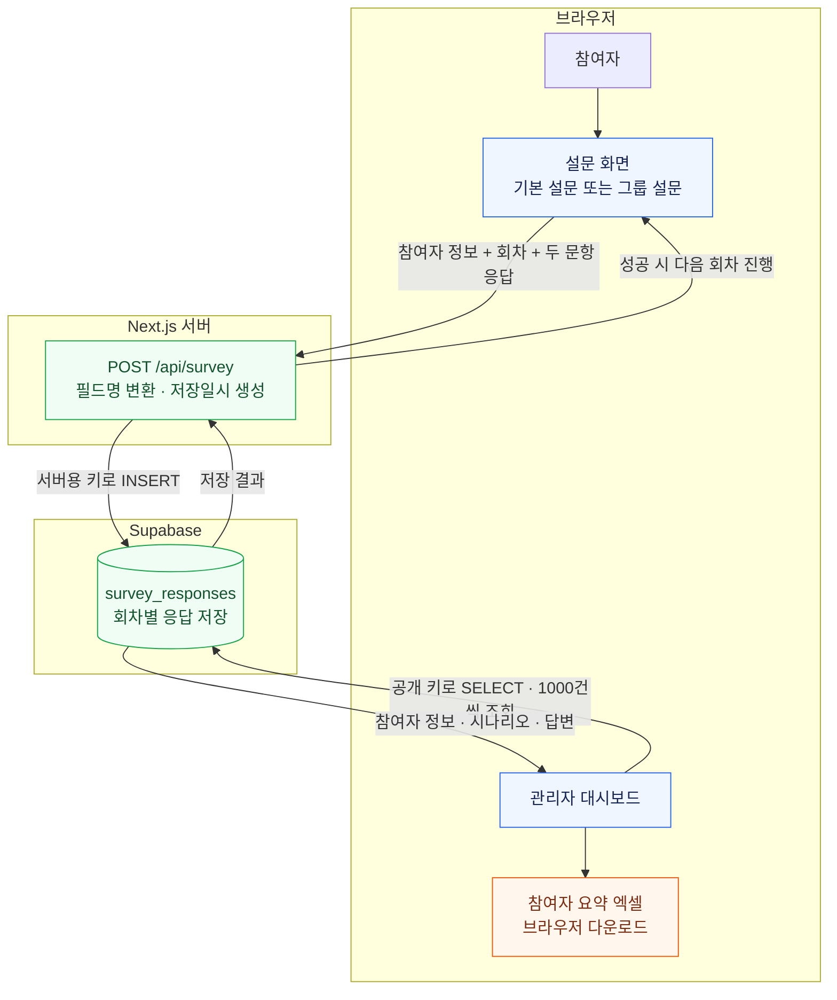
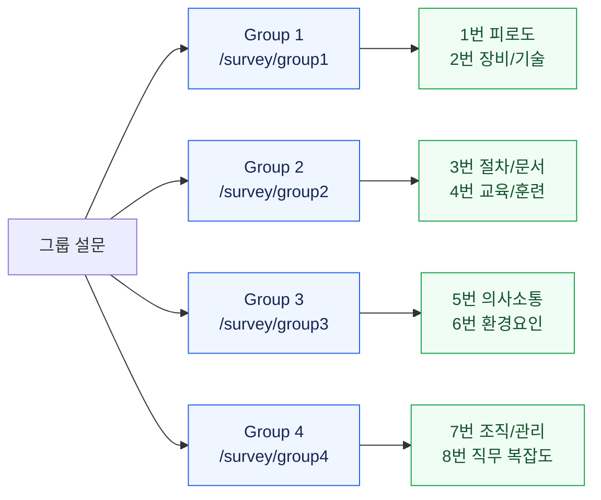
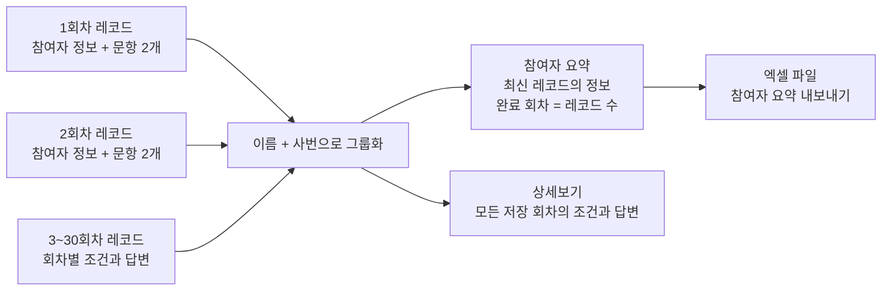
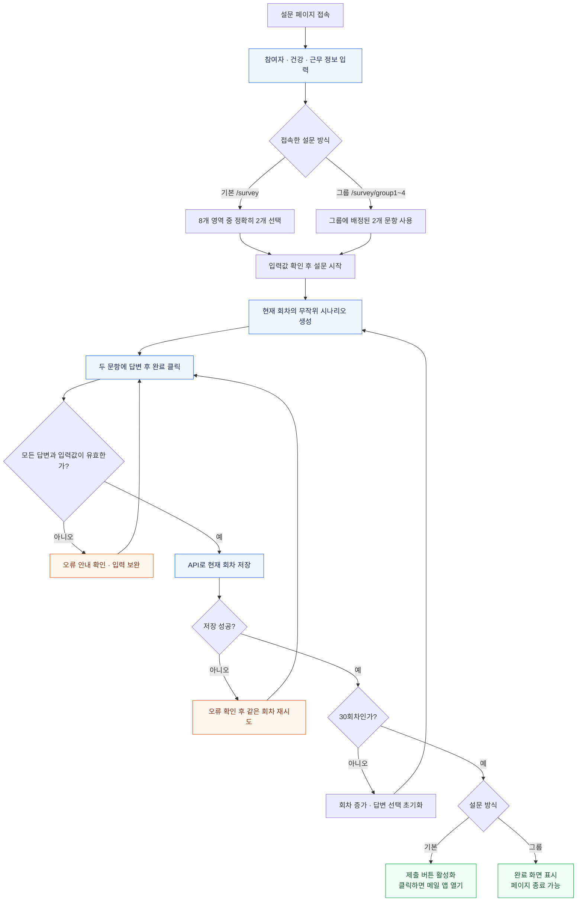

# Survey — 철도 종사자 온라인 설문

철도 종사자의 업무 수행 조건과 관련된 8개 PSF(Performance Shaping Factors, 수행영향인자) 영역을 조사하는 웹 애플리케이션입니다. 참여자는 기본 정보와 건강·근무 정보를 입력하고 무작위 시나리오에 답변합니다. 응답은 Supabase에 회차별로 저장되며 관리자 화면에서 결과와 통계를 조회할 수 있습니다.

- 저장소: [JungWonSeok97/survey](https://github.com/JungWonSeok97/survey)
- 화면 언어: 한국어
- 기본 설문: 문항 2개 선택 후 총 30회 응답
- 그룹 설문: 미리 정해진 문항 2개로 총 30회 응답

## 목차

- [주요 기능](#주요-기능)
- [한눈에 보는 시스템 구성](#한눈에-보는-시스템-구성)
- [설문 영역과 페이지](#설문-영역과-페이지)
- [기술 구성](#기술-구성)
- [로컬 실행](#로컬-실행)
- [Supabase 데이터 설정](#supabase-데이터-설정)
- [사용 방법](#사용-방법)
- [API](#api)
- [프로젝트 구조](#프로젝트-구조)
- [개발 및 운영 참고](#개발-및-운영-참고)
- [문제 해결](#문제-해결)

## 주요 기능

### 설문 참여

- 성명, 회사, 종사자 구분, 근속기간, 사번·직급·소속을 입력합니다.
- 생년월일, 연락처, 철도 자격증, 직무교육, 건강검진 및 근무 정보를 함께 수집합니다.
- 문항의 조건별 선택지 조합에서 무작위 시나리오를 생성합니다.
- 회차마다 같은 문항을 사용하고 시나리오를 새로 생성합니다. 무작위 추출이므로 이전 시나리오가 다시 나올 수 있습니다.
- 두 문항에 답변한 뒤 **완료**를 누르면 해당 회차를 저장하고 다음 회차로 이동합니다.
- 총 30회 진행률을 표시합니다.

### 관리자 조회

- Supabase 응답을 1,000건씩 나누어 읽고 저장일시가 최신인 순서로 표시합니다.
- 이름과 사번을 조합해 참여자를 구분하고 저장 레코드 수를 완료 회차로 표시합니다.
- 평균 근속년수, 평균 나이, 종사자 구분 및 직급별 분포를 제공합니다. 나이는 현재 연도에서 출생 연도를 빼서 계산합니다.
- 근속년수별 필터와 참여자별 상세보기에서 회차별 시나리오·답변을 확인할 수 있습니다.
- 현재 필터에 해당하는 참여자 목록을 `.xlsx` 파일로 다운로드합니다. 참여자 정보, 완료 회차, 최근 저장일시가 포함되며 회차별 문항과 답변은 포함되지 않습니다.

## 한눈에 보는 시스템 구성

참여자의 응답 저장과 관리자의 결과 조회는 서로 다른 경로로 이루어집니다. 아래 그림은 현재 코드의 데이터 흐름을 보여줍니다.



설문 화면은 DB에 직접 저장하지 않고 서버 API를 호출합니다. 반면 관리자 화면은 브라우저의 Supabase 클라이언트로 직접 조회합니다. 현재 임시 관리자 로그인은 이 DB 조회 권한과 연결되어 있지 않으며, 자세한 접근 권한과 운영 제약은 아래에서 설명합니다.

## 설문 영역과 페이지

문항과 조건 선택지는 `src/lib/surveyData.ts`에서 관리합니다.

| 문항 | PSF 영역 | 조사 내용 예시 |
| --- | --- | --- |
| 1 | 피로도 | 근무시간, 작업시간, 수면시간, 작업 허용 시간, 근무시간대 |
| 2 | 장비/기술 | 장비 가용성, 작업 도구, 컴퓨터 지원, 사용성, 유지보수 |
| 3 | 절차/문서 | 절차 가용성, 복잡성, 명료성, 적절성, 일관성, 추적성 |
| 4 | 교육/훈련 | 교육 프로그램, 교육 주기, 경험, 직무능력 평가, 숙련도 |
| 5 | 의사소통 | 메시지 길이, 장비, 전문용어, 프로토콜, 상황인식 공유 |
| 6 | 환경요인 | 기상, 작업공간, 마찰계수, 온습도, 통풍, 소음, 가시성 |
| 7 | 조직/관리 | 작업 관리·감독, 계획, 절차·규정, 역할 분담, 협업 |
| 8 | 직무 복잡도 | 의사결정 목표·대안·기준, 관측·추론 정보, 불확실성 |

| 경로 | 설명 |
| --- | --- |
| `/` | 서버에서 `/survey`로 리다이렉트 |
| `/survey` | 8개 문항 중 정확히 2개를 선택하는 설문 |
| `/survey/group1` | 1·2번: 피로도, 장비/기술 |
| `/survey/group2` | 3·4번: 절차/문서, 교육/훈련 |
| `/survey/group3` | 5·6번: 의사소통, 환경요인 |
| `/survey/group4` | 7·8번: 조직/관리, 직무 복잡도 |
| `/admin` | 임시 관리자 로그인 |
| `/admin/dashboard` | 응답 목록, 통계, 상세보기, 엑셀 다운로드 |
| `/api/health` | 서버 상태 확인용 JSON 응답 |
| `/ping` | `pong` 텍스트 응답 |
| `/main`, `/second` | 보조 페이지. `/main`은 로그인 UI 초안이며 실제 인증 기능은 없음 |

### 그룹별 문항 배정

기본 설문에서는 아래 8개 영역 중 참여자가 2개를 선택합니다. 그룹 설문에서는 주소에 따라 두 문항이 고정됩니다. 두 방식 모두 선택·배정된 문항을 유지하면서 30회 동안 조건 시나리오를 새로 제시합니다.



## 기술 구성

아래 버전은 `package.json` 기준입니다. 실제 설치 버전은 `package-lock.json`을 따릅니다.

| 구분 | 구성 |
| --- | --- |
| 웹 프레임워크 | Next.js 16.0.10, App Router |
| UI | React 19.2.0, React DOM 19.2.0 |
| 언어 | TypeScript 5 |
| 스타일 | Tailwind CSS 4 |
| 데이터 저장 | Supabase, `@supabase/supabase-js` ^2.76.1 |
| 통계 차트 | Recharts ^3.5.1 |
| 엑셀 내보내기 | SheetJS (`xlsx`) ^0.18.5 |
| 코드 검사 | ESLint 9, eslint-config-next |
| 글꼴 | `next/font/google`의 Geist, Geist Mono |

`pg`도 의존성에 포함되어 있지만 현재 설문 저장·조회 경로는 Supabase 클라이언트를 사용합니다.

## 로컬 실행

### 1. 준비 사항

- Node.js **20.9.0 이상**: 잠금 파일에 기록된 Next.js의 최소 요구 버전입니다.
- npm 및 Git
- Supabase 프로젝트와 `survey_responses` 테이블
- 프로젝트 URL, 브라우저용 공개 키, 서버용 키

### 2. 저장소 복제 및 설치

```bash
git clone https://github.com/JungWonSeok97/survey.git
cd survey
npm ci
```

`npm ci`는 커밋된 잠금 파일을 기준으로 의존성을 설치합니다.

### 3. 환경변수 설정

프로젝트 루트에 `.env.local`을 만들고 다음 값을 설정합니다. 저장소에는 환경변수 예제 파일이 포함되어 있지 않습니다.

```dotenv
NEXT_PUBLIC_SUPABASE_URL=https://YOUR_PROJECT.supabase.co
NEXT_PUBLIC_SUPABASE_ANON_KEY=YOUR_BROWSER_PUBLIC_KEY
SUPABASE_SERVICE_ROLE_KEY=YOUR_SERVER_ONLY_KEY
```

| 변수 | 사용 위치 | 용도 |
| --- | --- | --- |
| `NEXT_PUBLIC_SUPABASE_URL` | 브라우저 및 서버 | Supabase 프로젝트 URL |
| `NEXT_PUBLIC_SUPABASE_ANON_KEY` | `src/lib/supabase.ts` | 관리자 화면의 브라우저 데이터 조회 |
| `SUPABASE_SERVICE_ROLE_KEY` | `app/api/survey/route.ts` | 서버에서 설문 응답 저장 |

위 변수명은 현재 코드에서 읽는 이름입니다. 코드와 동일하게 설정하세요. 키 종류는 [Supabase 공식 API 키 문서](https://supabase.com/docs/guides/getting-started/api-keys)를 참고하세요.

`NEXT_PUBLIC_` 변수는 브라우저 코드에 포함됩니다. 서버용 키는 `SUPABASE_SERVICE_ROLE_KEY`에만 설정하고 공개 변수에 넣지 마세요. `.env*` 파일은 현재 `.gitignore`에서 제외됩니다.

### 4. 개발 서버 실행

```bash
npm run dev
```

[http://localhost:3000](http://localhost:3000)에 접속하면 기본 설문으로 이동합니다. 환경변수를 변경했다면 개발 서버를 다시 시작하세요.

### 5. 프로덕션 빌드 및 실행

```bash
npm run build
npm run start
```

`start`는 먼저 생성한 프로덕션 빌드를 실행합니다. 환경변수는 빌드 전에 설정하세요. 글꼴을 가져오기 위해 빌드 환경에서 Google Fonts에 접근할 수 있어야 합니다.

## Supabase 데이터 설정

### 저장 구조

웹 애플리케이션의 저장소는 Supabase의 **`survey_responses`** 테이블입니다. 회차를 완료할 때마다 참여자 정보와 두 문항의 응답이 한 레코드로 저장됩니다. 정상적으로 30회를 완료하면 참여자당 30개 레코드가 생성됩니다.

저장소에는 테이블 생성 SQL이나 마이그레이션 파일이 없습니다. 기존 DB를 연결하거나 아래 코드 요구사항을 기준으로 테이블을 별도로 준비해야 합니다. 자료형은 코드 입출력을 바탕으로 한 구성 예시이며 실제 운영 DB 스키마를 조회한 결과는 아닙니다.

| 컬럼 | 구성 예시 | 내용 |
| --- | --- | --- |
| `id` | 자동 생성 기본키 | 저장 성공 응답에서 반환하는 식별자 |
| `name`, `affiliation`, `job` | `text` | 성명, 회사, 종사자 구분 |
| `years` | `integer` | 근속년수. API에서 정수로 변환 |
| `employee_id`, `position`, `department` | `text` | 사번, 직급, 소속 |
| `gender` | `text` | 성별 |
| `date_of_birth` | `date` | 생년월일 |
| `office_phone`, `company_email` | `text` | 사무실 연락처, 회사 메일 |
| `railroad_certification`, `job_education` | `text` | 철도 자격증, 직무교육 이수 정보 |
| `health_check_date` | `timestamp` 또는 `text` | 시간대 정보가 없는 건강검진 일시 입력값 |
| `body_temperature`, `systolic_bp`, `diastolic_bp`, `pulse` | `text` 또는 `numeric` | 체온, 수축기·이완기 혈압, 맥박. 폼에서 문자열로 전송 |
| `work_type`, `work_time`, `employee_card_number` | `text` | 근무유형, 출퇴근 시간, 사원증 번호 |
| `round` | `integer` | 회차 번호, 기본 1~30 |
| `questions` | `jsonb` | 문항 ID, 표시 번호, 제시 조건, 답변 배열 |
| `saved_at` | `timestamptz` | API가 생성한 ISO 형식 저장일시 |

`questions`의 구조 예시입니다. `answer`는 숫자 인덱스가 아니라 선택한 **문자열**입니다.

```json
[
  {
    "id": 1,
    "number": "1.",
    "conditions": {
      "근무시간": "8시간 미만 근무할 경우"
    },
    "answer": "보통"
  }
]
```

구조 설명을 위해 한 문항과 한 조건만 표시했습니다. 실제 요청에는 두 문항과 각 문항의 모든 제시 조건이 포함됩니다. 클라이언트가 보내는 `selectedQuestions`는 현재 API에서 별도 컬럼으로 저장하지 않습니다.

### 회차별 데이터가 모이는 방식

참여자 정보는 회차마다 함께 저장됩니다. 참여자 전용 테이블이나 설문 세션 테이블을 별도로 사용하는 구조는 아닙니다. 아래 그림은 같은 이름·사번으로 30회를 정상 완료했을 때 관리자 화면이 데이터를 묶는 예시입니다.



따라서 **완료 회차 30**은 같은 참여자의 저장 레코드가 30개라는 뜻입니다. 중복 저장이나 재시작이 있으면 고유 회차를 모두 완료했다는 의미와 달라질 수 있습니다. 상세보기와 엑셀 내보내기도 목적이 다릅니다. 상세보기는 회차별 답변을 보여주고, 엑셀은 참여자별 요약을 제공합니다.

### 접근 권한

설문 저장은 서버 키로 수행하고 관리자 조회는 브라우저의 공개 키로 수행합니다. 현재 관리자 로그인은 Supabase Auth와 연결되어 있지 않으므로 화면에서 로그인해도 DB 요청이 인증된 관리자 요청으로 바뀌지 않습니다.

공개 스키마의 테이블에는 RLS를 활성화하고 데이터 접근 권한을 설계해야 합니다. 공개 키의 무제한 조회 정책으로 관리자 화면을 동작시키면 일반 사용자도 같은 키로 개인정보를 조회할 수 있습니다. 실제 개인정보를 운영하기 전에는 서버에서 검증하는 관리자 인증과 제한된 조회 경로를 구현해야 합니다. 테이블 권한과 RLS 정책은 별도 설정이며 자세한 내용은 [Supabase API 보안 문서](https://supabase.com/docs/guides/api/securing-your-api)를 참고하세요.

## 사용 방법

### 설문 진행 흐름

두 설문 방식은 문항을 정하는 단계와 마지막 화면에서 차이가 있습니다. 회차별 저장 요청이 실패하면 다음 회차로 넘어가지 않습니다.



예를 들어 Group 1 참여자는 매 회차 피로도와 장비/기술 문항에 답변합니다. 1회차 저장 성공 후 두 답변의 선택이 풀리고 2회차의 조건이 새로 표시됩니다. 마지막 30회차도 먼저 저장한 뒤 완료 화면으로 전환됩니다.

### 기본 설문

1. `/survey`에 접속합니다.
2. 참여자 정보와 건강·근무 정보를 입력합니다.
3. 8개 영역 중 정확히 2개를 선택하고 **설문 시작**을 누릅니다.
4. 제시된 조건을 읽고 각 문항의 답변을 선택합니다.
5. **완료**를 눌러 저장합니다. 저장 성공 후 다음 회차의 시나리오가 표시됩니다.
6. 30회를 완료합니다.

현재 폼은 입력 항목의 빈 값을 검사하고 성명은 한글만, 근속기간은 숫자만 허용합니다. 기본 설문의 종사자 구분은 기관사·관제사·승무원·작업자 중 선택합니다.

마지막 **제출** 버튼은 설정된 수신자에게 보내는 `mailto:` 링크를 엽니다. 메일을 자동 발송하거나 엑셀 파일을 자동 첨부하지 않습니다. 메일 본문에는 `survey_results` 폴더 안내가 있지만 현재 웹 코드에는 해당 폴더나 참여자별 엑셀 파일을 생성하는 기능이 없습니다. 응답 저장은 각 회차의 **완료** 시 이미 수행됩니다.

### 그룹 설문

배정받은 `/survey/group1`~`/survey/group4` 주소로 접속해 정보를 입력하고 시작합니다. 문항 선택 없이 해당 그룹의 두 문항에 30회 답변합니다. 마지막 회차 저장 후 완료 화면이 표시되며 페이지를 닫을 수 있습니다.

### 관리자

1. `/admin`에서 `app/admin/page.tsx`에 정의된 임시 비밀번호로 로그인합니다.
2. `/admin/dashboard`에서 목록과 통계를 확인합니다.
3. 필요하면 근속년수로 필터링하고 **상세보기**를 엽니다.
4. 엑셀 내보내기를 실행하면 현재 필터의 참여자 요약 파일을 다운로드합니다.

로그인 상태는 탭의 `sessionStorage`에 저장됩니다. 비밀번호 비교와 접근 확인이 브라우저에서만 이루어지므로 실제 관리자 권한을 보장하는 인증 구현은 아닙니다.

## API

### `POST /api/survey`

- 요청 형식: `Content-Type: application/json`
- 본문: 참여자 정보, `round`, `questions`
- camelCase 필드를 DB의 snake_case 컬럼으로 변환합니다. 예: `employeeId` → `employee_id`.
- `years`는 `parseInt`로 변환하며 변환되지 않으면 `0`을 저장합니다.
- 저장 성공: HTTP 200, `success: true`, 성공 메시지와 저장된 `id` 반환
- 저장 실패: HTTP 500, `success: false`와 오류 정보 반환

API에는 별도의 사용자 인증, 요청 필드 검증, 회차 범위 검증 또는 중복 저장 방지 로직이 없습니다. 브라우저 폼의 검증만으로 직접 API 요청을 제한할 수는 없습니다.

### `GET /api/health`

```json
{ "ok": true, "message": "✅ 서버가 정상 작동 중입니다" }
```

### `GET /ping`

```text
pong
```

두 상태 확인 경로는 서버 응답 여부만 확인하며 Supabase 연결이나 테이블 접근을 검사하지 않습니다.

## 프로젝트 구조

```text
survey/
├── app/
│   ├── page.tsx                    # 기본 설문으로 리다이렉트
│   ├── layout.tsx                  # 한국어 설정, 메타데이터, 글꼴
│   ├── globals.css                 # 전역 스타일
│   ├── survey/
│   │   ├── page.tsx                # 문항 선택형 설문
│   │   └── group1~group4/page.tsx   # 각 그룹별 별도 디렉터리의 설문 페이지
│   ├── admin/
│   │   ├── page.tsx                # 임시 관리자 로그인
│   │   └── dashboard/page.tsx      # 통계, 상세보기, 엑셀 내보내기
│   ├── api/
│   │   ├── survey/route.ts         # Supabase 저장 API
│   │   └── health/route.ts         # 상태 확인
│   ├── ping/route.ts               # 간단한 응답 확인
│   ├── main/page.tsx               # 로그인 UI 초안
│   └── second/page.tsx             # 보조 페이지
├── src/
│   ├── components/
│   │   ├── SurveyForm.tsx          # 그룹 설문 공통 폼
│   │   └── MultipleChoiceQuestion.tsx
│   └── lib/
│       ├── surveyData.ts           # 문항, 조건, 선택지 정의
│       └── supabase.ts             # 브라우저용 Supabase 클라이언트
├── data/survey.db                  # 기존 SQLite 파일
├── public/                        # 정적 파일
├── check-supabase.js               # Supabase 응답 조회 스크립트
├── check-db.js                     # 기존 SQLite 요약 조회
├── view-db-full.js                 # 기존 SQLite 상세 조회
├── next.config.ts                 # Turbopack 루트, 압축 등 설정
├── package.json
└── package-lock.json
```

`data/survey.db`와 SQLite 조회 스크립트는 현재 웹 API의 저장 경로와 연결되어 있지 않습니다.

## 개발 및 운영 참고

### 명령어

| 명령어 | 용도 |
| --- | --- |
| `npm run dev` | 개발 서버 실행 |
| `npm run build` | 프로덕션 빌드 |
| `npm run start` | 프로덕션 서버 실행 |
| `npm run lint` | ESLint 검사 |

자동화된 테스트 스크립트는 현재 `package.json`에 없습니다.

### 설문 수정 위치

- 문항·조건·답변 선택지: `src/lib/surveyData.ts`
- 공통 문항 표시: `src/components/MultipleChoiceQuestion.tsx`
- 그룹별 문항 배정: `app/survey/group1`~`group4`의 `page.tsx`
- 회차 수: `app/survey/page.tsx`와 `src/components/SurveyForm.tsx`의 `TOTAL_ROUNDS`
- 관리자 진행률: `app/admin/dashboard/page.tsx`에도 기준값 `30`이 직접 사용되므로 회차 변경 시 함께 수정
- 참여자 필드: 기본 설문, 공통 그룹 폼, 저장 API, DB 스키마, 관리자 표시·내보내기를 함께 확인

### 데이터 조회 스크립트

`.env.local` 설정 후 개발용 Supabase 데이터 조회는 다음과 같이 실행할 수 있습니다.

```bash
node check-supabase.js
```

이 스크립트는 `dotenv`를 직접 사용합니다. 현재 `dotenv`는 `dotenv-cli`의 전이 의존성으로 잠금 파일에 포함되어 있으며 직접 의존성으로 선언되어 있지는 않습니다. 스크립트는 페이지네이션 없이 조회하므로 서버의 응답 건수 제한에 따라 전체 데이터가 반환되지 않을 수 있습니다.

`check-db.js`와 `view-db-full.js`는 `better-sqlite3`를 요구하지만 해당 패키지는 현재 의존성에 없습니다. 기본 설치만으로는 실행할 수 없으며 Supabase에 저장한 새 응답도 조회하지 않습니다.

### 현재 구현의 운영상 제약

- 새로고침하면 참여자 정보, 문항 선택, 현재 회차가 초기화됩니다. 이미 저장된 DB 응답은 유지되지만 이어서 작성하는 기능은 없습니다.
- 관리자 완료 회차는 저장 레코드 수입니다. 동일 참여자가 재시작하거나 중복 제출하면 30을 초과할 수 있으며 별도 설문 세션 구분은 없습니다.
- API는 설문 입력 전체를 서버 로그에 출력하고 오류 상세를 응답에 포함합니다. 실제 개인정보를 다루는 배포에서는 로그 및 오류 반환 범위를 조정해야 합니다.
- 개인정보·건강 정보를 수집하므로 실제 운영 전에 관리자 인증, DB 접근 정책, 수집 안내와 보관·삭제 절차를 정해야 합니다.

배포 환경에서는 동일한 세 환경변수를 설정하고 Next.js 서버 기능을 지원하는 실행 환경을 사용하세요. `/api/survey`가 서버에서 동작하므로 정적 파일만 호스팅하는 방식으로는 설문 저장을 제공할 수 없습니다.

## 문제 해결

| 증상 | 확인할 사항 |
| --- | --- |
| Supabase URL·키 관련 실행 또는 빌드 오류 | `.env.local` 위치와 세 변수명 확인. 클라이언트가 모듈 로딩 시 생성되므로 요청 전에도 설정이 필요 |
| 설문 저장 중 오류 | 개발 서버 로그, 네트워크 탭의 `/api/survey` 응답, 서버 키, 테이블·컬럼명 확인 |
| 관리자 목록이 비어 있거나 권한 오류 | 공개 키, 테이블 권한, RLS 정책 확인. 임시 화면 로그인은 Supabase 인증을 생성하지 않음 |
| 상태 확인은 정상인데 저장 실패 | 상태 확인 API는 DB를 검사하지 않으므로 Supabase 설정을 별도로 확인 |
| 다음 회차로 이동하지 않음 | 두 문항 응답, 입력값 검증, 저장 요청 성공 여부 확인 |
| 제출해도 메일이 발송되지 않음 | `mailto:`를 처리할 메일 앱 설정 확인. 실제 발송은 사용자가 메일 앱에서 수행 |
| 엑셀에 상세 답변이 없음 | 현재 내보내기는 참여자 요약만 제공. 회차별 답변은 관리자 상세보기에서 확인 |
| 글꼴 관련 빌드 실패 | 빌드 환경의 Google Fonts 네트워크 접근 확인 |

버그 보고 시 재현 경로, 오류 메시지, 사용 환경을 기록하되 서버 키나 실제 참여자의 개인정보는 포함하지 마세요.
