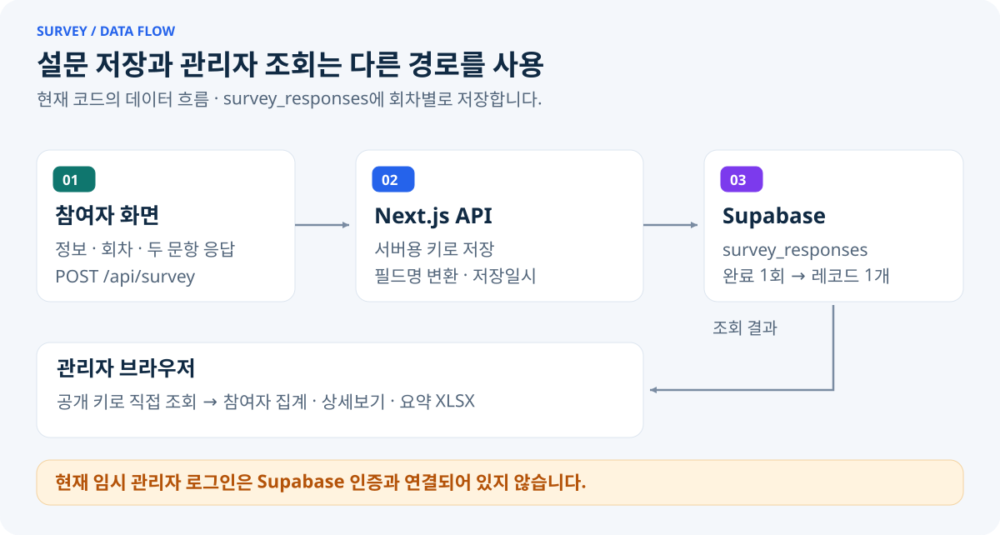
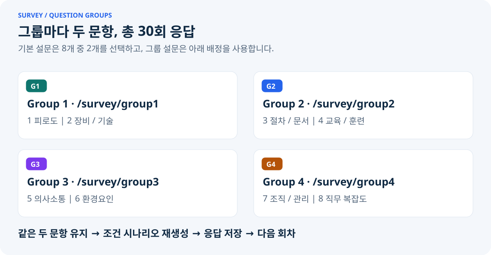
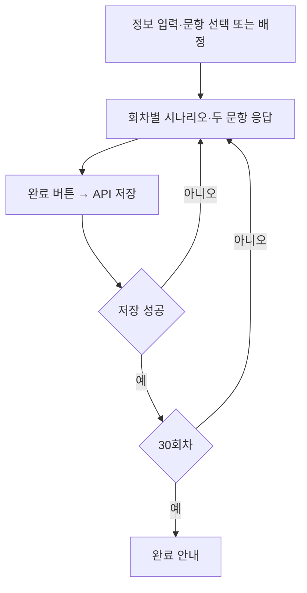

# Survey — 철도 종사자 PSF 시나리오 설문

철도 종사자에게 작업 조건 시나리오를 제시하고, **8개 PSF 영역 중 2개 문항에 총 30회 응답**하도록 구성한 한국어 설문 웹 애플리케이션입니다. Next.js 서버가 회차별 응답을 Supabase에 저장하며, 관리자 화면에서 참여자별 진행 현황·통계·상세 응답을 조회합니다.

[전체 프로젝트](https://github.com/JungWonSeok97/Railway_Human_Error) · [PSF·HEP 예측 앱](https://github.com/JungWonSeok97/Railway_hep) · [정확도 연구보고서](https://github.com/abitocodes/rail-psf-accuracy-memo)

## 목차

- [기능과 데이터 흐름](#기능과-데이터-흐름)
- [설문 구성과 페이지](#설문-구성과-페이지)
- [설치와 실행](#설치와-실행)
- [환경 변수](#환경-변수)
- [데이터베이스 계약](#데이터베이스-계약)
- [참여자와 관리자 사용 방법](#참여자와-관리자-사용-방법)
- [API](#api)
- [프로젝트 구조](#프로젝트-구조)
- [개발과 검증](#개발과-검증)
- [운영과 배포](#운영과-배포)
- [문제 해결](#문제-해결)

## 기능과 데이터 흐름

| 구분 | 기능 |
| --- | --- |
| 기본 설문 | 참여자가 8개 영역 중 정확히 2개 선택 |
| 그룹 설문 | 주소에 따라 두 문항 고정 배정 |
| 시나리오 | 조건 선택지의 조합에서 무작위 추출 |
| 진행 | 같은 두 문항으로 30회 진행, 회차마다 조건 재생성 |
| 저장 | 참여자 정보 + 현재 회차 + 두 문항의 조건·답변 |
| 관리자 | 목록, 통계 차트, 근속년수 필터, 참여자별 상세보기 |
| 내보내기 | 현재 필터의 참여자 요약 XLSX |



*그림 1. 저장과 조회의 실제 경로. 관리자 화면의 임시 로그인과 DB 접근 권한은 별개입니다.*

응답 저장은 서버 API, 관리자 조회는 브라우저의 Supabase 클라이언트를 사용합니다. **현재 관리자 로그인은 브라우저 내부 확인이며 Supabase 인증과 연결되어 있지 않습니다.** 실제 데이터로 운영할 때의 영향은 [운영과 배포](#운영과-배포)에 설명합니다.

이 저장소는 설문 수집·조회 앱입니다. HEP 계산이나 모델 학습은 수행하지 않으며 다른 저장소로 응답을 자동 전송하지 않습니다.

## 설문 구성과 페이지

문항·조건·답변 선택지는 [src/lib/surveyData.ts](src/lib/surveyData.ts)에 정의됩니다.



*그림 2. 그룹별 고정 문항 배정. 매 회차 두 문항은 유지하고 제시 조건을 새로 생성합니다.*

| 문항 | 설문 영역 | 조사 조건 예시 | 고정 그룹 |
| --- | --- | --- | --- |
| 1 | 피로도 | 근무·작업·수면시간, 작업 허용 시간, 근무시간대 | Group 1 |
| 2 | 장비/기술 | 가용성, 도구, 컴퓨터 지원, 사용성, 유지보수 | Group 1 |
| 3 | 절차/문서 | 가용성, 복잡성, 명료성, 적절성, 일관성, 추적성 | Group 2 |
| 4 | 교육/훈련 | 프로그램, 주기, 경험, 능력 평가, 숙련도 | Group 2 |
| 5 | 의사소통 | 메시지, 장비, 용어, 프로토콜, 상황인식 공유 | Group 3 |
| 6 | 환경요인 | 기상, 공간, 마찰계수, 온습도, 통풍, 소음, 가시성 | Group 3 |
| 7 | 조직/관리 | 관리·감독, 계획, 절차·규정, 역할, 협업 | Group 4 |
| 8 | 직무 복잡도 | 목표·대안·기준, 관측·추론 정보, 불확실성 | Group 4 |

설문 화면의 영역 명칭과 예측 앱의 PSF 명칭은 일부 다릅니다. 모델용 데이터로 변환할 때에는 조건과 수준 인코딩까지 확인합니다.

| 경로 | 역할 |
| --- | --- |
| `/` | 서버에서 `/survey`로 이동 |
| `/survey` | 문항 선택형 설문 |
| `/survey/group1` | 1·2번 문항 |
| `/survey/group2` | 3·4번 문항 |
| `/survey/group3` | 5·6번 문항 |
| `/survey/group4` | 7·8번 문항 |
| `/admin` | 임시 관리자 로그인 |
| `/admin/dashboard` | 통계·목록·상세보기·내보내기 |
| `/api/survey` | 응답 저장 API |
| `/api/health`, `/ping` | 서버 응답 확인 |
| `/main`, `/second` | 보조 페이지. `/main` 로그인 UI는 실제 인증 기능이 없음 |

시나리오는 무작위로 뽑으므로 같은 조건이 다시 나올 수 있습니다. 중복 없이 모든 조합을 배정하는 기능은 아닙니다.

## 설치와 실행

### 기술 구성

아래는 `package.json` 기준입니다. 실제 설치 버전은 커밋된 `package-lock.json`을 따릅니다.

| 구분 | 구성 |
| --- | --- |
| 프레임워크 | Next.js 16.0.10, App Router |
| UI | React / React DOM 19.2.0 |
| 언어·스타일 | TypeScript 5, Tailwind CSS 4 |
| DB 클라이언트 | @supabase/supabase-js ^2.76.1 |
| 차트 | Recharts ^3.5.1 |
| XLSX | xlsx ^0.18.5 |
| 코드 검사 | ESLint 9 |
| 글꼴 | `next/font/google`의 Geist, Geist Mono |

`pg`도 의존성에 있지만 현재 웹 저장·조회 경로는 Supabase 클라이언트를 사용합니다.

### 준비 및 설치

- Node.js **20.9.0 이상**: 현재 잠금 파일에 기록된 Next.js의 최소 요구사항
- npm, Git
- Supabase 프로젝트, `survey_responses` 테이블 및 접근 설정
- 아래 세 환경 변수

```bash
git clone https://github.com/JungWonSeok97/survey.git
cd survey
npm ci
```

상위 저장소에서 받았다면 초기화된 `survey/` 안에서 실행합니다. `npm ci`는 잠금 파일 기준으로 의존성을 설치합니다.

`.env.local`과 DB를 준비한 후 개발 서버를 시작합니다.

```bash
npm run dev
```

**http://localhost:3000**에 접속하면 기본 설문으로 이동합니다. 환경 변수를 바꿨다면 서버를 재시작합니다.

프로덕션 실행:

```bash
npm run build
npm run start
```

`start`는 먼저 생성한 빌드가 필요합니다. 빌드 전 환경 변수를 설정하고 Google Fonts 다운로드를 위한 네트워크 접근도 확인합니다.

## 환경 변수

프로젝트 루트에 `.env.local`을 만듭니다. 아래 값은 예시이며 실제 프로젝트 값으로 교체합니다. 저장소에는 환경 변수 예제 파일이 없습니다.

```dotenv
NEXT_PUBLIC_SUPABASE_URL=https://YOUR_PROJECT.supabase.co
NEXT_PUBLIC_SUPABASE_ANON_KEY=YOUR_BROWSER_PUBLIC_KEY
SUPABASE_SERVICE_ROLE_KEY=YOUR_SERVER_ONLY_KEY
```

| 변수 | 읽는 코드 | 용도 |
| --- | --- | --- |
| `NEXT_PUBLIC_SUPABASE_URL` | 브라우저 클라이언트, 저장 API | 프로젝트 URL |
| `NEXT_PUBLIC_SUPABASE_ANON_KEY` | `src/lib/supabase.ts` | 관리자 브라우저의 조회 |
| `SUPABASE_SERVICE_ROLE_KEY` | `app/api/survey/route.ts` | 서버의 응답 저장 |

`NEXT_PUBLIC_` 값은 브라우저 코드에 포함됩니다. 서버용 키를 공개 변수에 넣지 않습니다. `.env*`는 현재 Git에서 제외됩니다.

클라이언트가 모듈 로딩 시 생성되므로 API를 호출하기 전에도 URL·키 누락으로 실행·빌드가 실패할 수 있습니다. 공개 변수 변경 후 배포 환경에서는 다시 빌드합니다.

## 데이터베이스 계약

### 저장 단위

현재 테이블은 **`survey_responses`**입니다. 두 문항에 응답하고 회차의 **완료**를 누를 때마다 한 레코드가 생성됩니다. 참여자 정보는 회차마다 반복 저장됩니다.

- 30회 정상 완료: 30개 레코드, 문항 응답 60개
- 참여자·설문 세션을 별도 테이블로 관리하지 않음
- 재시작·중복 제출에 대한 고유 세션 식별자나 중복 방지 없음
- `selectedQuestions`는 프런트엔드에서 보내지만 API가 별도 컬럼에 저장하지 않음

저장소에는 테이블 생성 SQL·마이그레이션이 없습니다. 아래 표는 **코드가 요구하는 컬럼과 자료형 예시**이며 운영 DB를 조회해 확인한 스키마는 아닙니다. 기존 DB의 제약·기본값·권한을 대조해 구성합니다.

| 컬럼 | 자료형 예시 | 용도 |
| --- | --- | --- |
| `id` | 자동 생성 기본키 | 저장 성공 시 반환 |
| `name`, `affiliation`, `job` | text | 성명, 회사, 종사자 구분 |
| `years` | integer | 근속년수, API에서 정수 변환 |
| `employee_id`, `position`, `department` | text | 사번, 직급, 소속 |
| `gender` | text | 성별 |
| `date_of_birth` | date | 생년월일 |
| `office_phone`, `company_email` | text | 연락처 |
| `railroad_certification`, `job_education` | text | 자격증, 직무교육 |
| `health_check_date` | timestamp 또는 text | 시간대 없는 건강검진 입력값 |
| `body_temperature`, `systolic_bp`, `diastolic_bp`, `pulse` | text 또는 numeric | 건강 수치, 폼에서는 문자열 전송 |
| `work_type`, `work_time`, `employee_card_number` | text | 근무 정보, 사원증 번호 |
| `round` | integer | 회차 번호, 화면 기준 1–30 |
| `questions` | jsonb | 두 문항의 조건·답변 배열 |
| `saved_at` | timestamptz | API가 생성한 저장일시 |

`questions` 구조를 설명하기 위한 **축약 예시**입니다. 실제 요청에는 두 문항과 각각의 전체 제시 조건이 포함됩니다.

```json
[
  {
    "id": 1,
    "number": "1.",
    "conditions": {
      "근무시간": "8시간 미만 근무할 경우"
    },
    "answer": "보통"
  }
]
```

`answer`는 실제 폼에서 **문자열**로 전달합니다. `src/lib/supabase.ts`의 `SurveyResponse` 타입에는 `questionId`·숫자형 `answer`가 남아 있어 실제 요청과 차이가 있습니다. 연동 시에는 폼의 직렬화 코드와 API를 기준으로 확인합니다.

### 관리자 집계 방식

관리자 화면은 저장일시 내림차순으로 1,000건씩 조회한 뒤 **이름 + 사번**으로 묶습니다. 참여자 요약에는 최신 레코드의 정보를 사용하고, 완료 회차는 저장 레코드 수로 표시합니다.

따라서 완료 회차가 30이어도 고유한 1–30회차가 한 번씩 저장되었다는 보장은 없습니다. 재시작·중복 제출 시 30을 초과할 수 있습니다. 평균 나이는 현재 연도에서 출생 연도를 빼 계산합니다.

XLSX에는 참여자 정보·완료 회차·최근 저장일시가 들어가며, **회차별 조건·답변은 포함되지 않습니다.** 상세 응답은 관리자 상세보기에서 확인합니다.

## 참여자와 관리자 사용 방법

### 참여자

1. 기본 설문 또는 배정된 그룹 주소로 접속합니다.
2. 참여자·건강·근무 정보를 입력합니다.
3. 기본 설문에서는 정확히 2개 문항을 선택합니다. 그룹 설문은 배정된 문항을 사용합니다.
4. 설문을 시작하고 제시된 조건에 맞는 답변을 선택합니다.
5. **완료**를 누릅니다. 저장에 성공하면 다음 회차로 진행합니다.
6. 30회까지 반복합니다.

입력 폼은 빈 값과 성명·근속기간 등의 형식을 확인합니다. 기본 설문의 종사자 구분은 기관사·관제사·승무원·작업자 중 선택합니다.



저장 실패 시 다음 회차로 넘어가지 않습니다. 새로고침하면 화면의 참여자 정보·회차가 초기화되며 이어쓰기 기능은 없습니다. 이미 저장한 DB 레코드는 유지됩니다.

기본 설문의 마지막 **제출** 버튼은 `mailto:`로 메일 앱을 엽니다. 자동 발송·첨부 기능은 없습니다. 메일 본문에 언급된 `survey_results` 폴더나 참여자별 XLSX도 현재 웹 코드가 생성하지 않습니다. 응답은 각 회차 완료 시 이미 DB에 저장됩니다. 그룹 설문은 30회 저장 후 완료 화면을 표시합니다.

### 관리자

1. `/admin`에서 `app/admin/page.tsx`에 정의된 임시 로그인 정보를 사용합니다.
2. `/admin/dashboard`에서 참여자 목록·통계를 확인합니다.
3. 근속년수로 필터링하고 상세보기에서 회차별 조건·답변을 확인합니다.
4. 필요한 경우 필터에 해당하는 참여자 요약 XLSX를 내려받습니다.

로그인 표시는 `sessionStorage`의 `adminLoggedIn`으로 관리합니다. 이는 서버에서 검증하는 관리자 권한이 아닙니다.

## API

### POST /api/survey

`Content-Type: application/json`으로 참여자 정보, `round`, `questions`를 전달합니다. 실제 필드 목록은 [저장 API](app/api/survey/route.ts)를 기준으로 합니다.

- 요청의 camelCase를 DB의 snake_case로 변환: `employeeId` → `employee_id` 등
- `years`는 `parseInt`로 변환하며 변환 실패 시 0
- `saved_at`은 서버가 `new Date().toISOString()`으로 생성
- Supabase에 insert 후 생성 레코드 조회
- 성공: HTTP 200, `success`·`message`·`id`
- 실패: HTTP 500, `success: false` 및 오류 정보

성공 응답 형태:

```json
{
  "success": true,
  "message": "저장되었습니다.",
  "id": "DB에서 생성된 식별자"
}
```

현재 API에는 사용자 인증, 서버 측 필드 검증, 회차 범위 검사, 중복 저장 방지가 없습니다. 폼의 입력 검사는 직접 API 요청을 제한하지 않습니다.

### 상태 확인

| 경로 | 응답 |
| --- | --- |
| `GET /api/health` | `{"ok":true,"message":"✅ 서버가 정상 작동 중입니다"}` |
| `GET /ping` | `pong` 텍스트 |

PowerShell에서 실행 중인 서버를 확인할 수 있습니다.

```powershell
Invoke-RestMethod 'http://localhost:3000/api/health'
Invoke-RestMethod 'http://localhost:3000/ping'
```

이 경로들은 서버 응답 여부만 확인하며 Supabase 연결·테이블·권한은 검사하지 않습니다.

## 프로젝트 구조

```text
survey/
├── app/
│   ├── page.tsx                    # /survey 리다이렉트
│   ├── layout.tsx                  # 한국어·메타데이터·글꼴
│   ├── globals.css
│   ├── survey/
│   │   ├── page.tsx                # 기본 설문
│   │   ├── group1/page.tsx         # 1·2번
│   │   ├── group2/page.tsx         # 3·4번
│   │   ├── group3/page.tsx         # 5·6번
│   │   └── group4/page.tsx         # 7·8번
│   ├── admin/
│   │   ├── page.tsx                # 임시 로그인
│   │   └── dashboard/page.tsx      # 조회·통계·XLSX
│   ├── api/
│   │   ├── survey/route.ts         # 저장 API
│   │   └── health/route.ts         # 상태 확인
│   ├── ping/route.ts
│   ├── main/page.tsx               # 보조 UI
│   └── second/page.tsx
├── src/
│   ├── components/
│   │   ├── SurveyForm.tsx          # 그룹 설문 공통 폼
│   │   └── MultipleChoiceQuestion.tsx
│   └── lib/
│       ├── surveyData.ts           # 문항·조건·선택지
│       └── supabase.ts             # 브라우저 클라이언트
├── data/survey.db                  # 기존 SQLite 파일
├── public/
├── check-supabase.js               # Supabase 조회 보조 도구
├── check-db.js                     # 기존 SQLite 조회
├── view-db-full.js                 # 기존 SQLite 상세 조회
├── next.config.ts
├── package.json
└── package-lock.json
```

`data/survey.db`와 SQLite 스크립트는 현재 웹 저장 API와 연결되어 있지 않습니다.

## 개발과 검증

| 명령 | 용도 |
| --- | --- |
| `npm ci` | 잠금 파일 기준 설치 |
| `npm run dev` | 개발 서버 |
| `npm run lint` | ESLint |
| `npm run build` | 프로덕션 빌드 |
| `npm run start` | 생성된 빌드 실행 |

`package.json`에는 자동화 테스트 명령이 없습니다. lint/build 통과와 실제 DB 저장 확인은 별도입니다.

기능 확인은 테스트용 DB와 가상 참여자 정보로 진행합니다.

1. 기본 설문과 네 그룹의 문항 배정을 확인합니다.
2. 한 회차를 완료하고 `/api/survey` 성공 응답 및 DB의 조건·답변을 대조합니다.
3. 저장 실패 시 회차가 유지되는지 확인합니다.
4. 관리자 집계·상세보기·필터·XLSX 범위를 확인합니다.
5. 마지막 회차의 완료 동작과 새로고침 시 상태 초기화를 확인합니다.

### 수정 위치

| 변경 사항 | 함께 확인할 곳 |
| --- | --- |
| 문항·조건·선택지 | `surveyData.ts`, `MultipleChoiceQuestion.tsx` |
| 그룹 배정 | `app/survey/group1`–`group4` |
| 총 회차 | 기본 설문·공통 폼의 `TOTAL_ROUNDS`, 대시보드의 직접 입력된 `30` |
| 참여자 필드 | 기본·공통 폼, API, DB 스키마, 관리자 표시·내보내기 |
| 인증·조회 권한 | 관리자 페이지, 대시보드, Supabase 클라이언트 및 DB 정책 |

### 기존 조회 도구

`node check-supabase.js`는 `.env.local`을 읽어 개발용 조회를 수행합니다. 페이지네이션이 없어 DB 응답 건수 제한에 따라 전체 레코드를 가져오지 못할 수 있으며, 실제 정보가 터미널에 출력될 수 있습니다. 스크립트가 사용하는 `dotenv`는 현재 직접 의존성이 아니라 `dotenv-cli`의 전이 의존성입니다.

`check-db.js`와 `view-db-full.js`는 `better-sqlite3`를 요구하지만 현재 의존성에 선언되어 있지 않습니다. 기본 설치만으로 실행되지 않으며 Supabase의 새 응답을 조회하는 도구도 아닙니다.

## 운영과 배포

이 앱은 서버 API가 있으므로 Next.js 서버 기능을 지원하는 호스팅 환경이 필요합니다. 정적 파일 호스팅만으로 저장 API를 제공할 수 없습니다.

배포 환경에서는 프로젝트의 실행 루트, Node.js, 설치·빌드 명령, 세 환경 변수를 설정합니다. `NEXT_PUBLIC_` 값은 빌드에 반영되므로 변경 후 재빌드합니다. 상위 저장소로 배포를 구성한다면 서브모듈을 내려받고 `survey/`를 앱 루트로 지정해야 합니다.

현재 코드에서 확인되는 운영 제약은 다음과 같습니다.

| 항목 | 현재 구현과 영향 |
| --- | --- |
| 관리자 인증 | 클라이언트의 비밀번호 비교·세션 플래그. 서버 관리자 권한 검증 없음 |
| 관리자 DB 조회 | 공개 키로 브라우저가 직접 SELECT. 임시 로그인은 DB 인증 상태를 바꾸지 않음 |
| 테이블 접근 정책 | 저장소에 정책 정의 없음. 실제 DB의 RLS·권한을 별도로 확인해야 함 |
| 저장 검증 | 직접 API 요청에 대한 필드·회차·중복 검사 없음 |
| 로그 | API가 참여자·건강 정보를 포함한 저장 데이터를 로그에 출력 |
| 오류 응답 | DB 오류 상세와 일부 예외 스택을 반환 |
| 재개·중복 | 이어쓰기·설문 세션 구분·중복 제출 방지 없음 |

관리자 화면을 작동시키기 위해 공개 키의 무제한 조회를 허용하면 동일한 키로 데이터에 접근할 수 있습니다. 실제 참여자 정보를 운영하기 전에는 서버가 검증하는 관리자 인증과 제한된 조회 경로를 구현하고, 로그·오류 반환 범위도 조정해야 합니다. 현재 로그인 화면만으로 데이터 접근이 보호된다고 가정하지 않습니다.

환경 변수, DB 내보내기, 참여자 XLSX를 커밋하거나 이슈에 첨부하지 않습니다. `.gitignore`의 환경 변수 제외 규칙은 모든 응답 데이터 파일을 자동으로 제외하지 않습니다.

## 문제 해결

| 증상 | 확인할 사항 |
| --- | --- |
| 실행·빌드 시 Supabase URL·키 오류 | `.env.local` 위치, 세 변수명, 모듈 로딩 시 설정 존재 여부 |
| 설문 저장 실패 | 네트워크 응답, 서버 로그, 서버용 키, 테이블·컬럼·제약 |
| 관리자 목록이 비거나 조회 실패 | 공개 키·테이블 권한·RLS. 임시 로그인은 DB 인증을 생성하지 않음 |
| health는 정상인데 저장 실패 | health는 DB를 검사하지 않음 |
| 다음 회차로 이동하지 않음 | 두 문항 응답, 입력값 검사, API 성공 여부 |
| 완료 회차가 30 초과 | 같은 이름·사번의 중복 저장·재시작 여부 |
| 제출 버튼이 메일을 자동 발송하지 않음 | 현재 `mailto:` 동작. 발송은 메일 앱에서 수행 |
| XLSX에 상세 응답이 없음 | 현재 내보내기는 참여자 요약만 제공 |
| 글꼴 관련 빌드 실패 | Google Fonts 접근 가능 여부 |
| SQLite 스크립트 실행 실패 | 별도 의존성 필요, 현재 웹 DB와 다른 도구 |

이슈에는 재현 경로·오류 메시지·Node.js 버전을 남기고, 실제 참여자의 정보나 서버용 키는 제거합니다.
